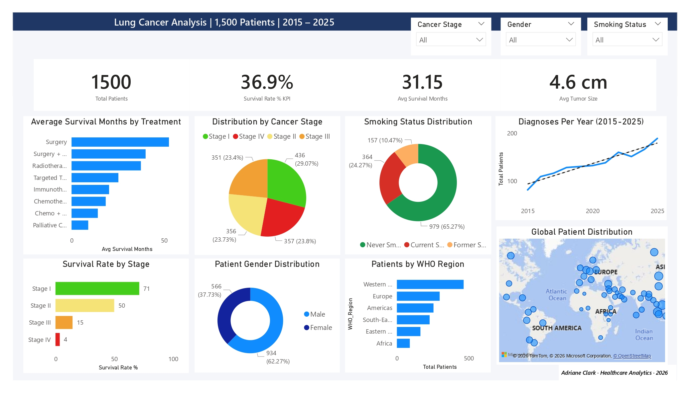

# Exploratory-Data-Analysis-on-Lung-Cancer-Patient-Trends-and-Indicators 🫁  

> An end-to-end data analytics project examining **1,500 lung cancer patients** across 6 WHO regions (2015–2025), covering data cleaning, SQL querying, Excel modeling, and Power BI dashboard design.

---

## 📸 Dashboard Preview



> *Built in Power BI Desktop — 1-page interactive dashboard with slicers for Stage, Gender, and Smoking Status.*

---

## 📁 Repository Structure

```
lung-cancer-analysis/
│
├── 📂 data/
│   └── lung_cancer_dataset.csv          ← Raw source data (1,500 rows · 41 columns)
|
├── 📂 excel/
│   └── lung_cancer_analysis.xlsx        ← Excel workbook (5 sheets)
│
├── 📂 insights/
│   ├── dash.jpg                         ← Screenshot of the Power BI dashboard
│
├── 📂 powerbi/
│   └── dash.pbix                        ← Power BI Desktop file
│
├── 📂 sql/
│   └── lung_cancer_queries.sql          ← 25+ queries across 8 sections (MySQL)
│
└── README.md                            ← You are here
```

---

## 🎯 Business Questions Answered

1. What is the overall survival rate, and how does it vary by cancer stage?
2. Which treatment type produces the best survival outcomes?
3. Are smokers more likely to be diagnosed at a later stage?
4. Which WHO regions have the highest patient burden?
5. How has the annual number of diagnoses trended from 2015 to 2025?
6. What is the relationship between tumor size and cancer stage?

---
---

## 📊 Key Findings

**Dataset:** 1,500 lung cancer patients diagnosed between 2015 and 2025 across 60 countries and 6 WHO regions, with 41 variables covering demographics, smoking and environmental exposure, symptoms, genetic mutations, cancer type and stage, diagnosis method, treatment, survival time (months) and survival outcome. There are no missing values or duplicate records.

| Metric | Value |
|---|---|
| Patients | 1,500 (62.3% male, mean age 60.7) |
| Cancer type | NSCLC 1,335 (89.0%), SCLC 165 (11.0%) |
| Diagnosed at Stage III/IV | 708 (47.2%) |
| Metastasis at diagnosis | 423 (28.2%) |
| Survived (`Survived = Yes`) | 553 (36.9%) |
| Survival time | median 26 months, mean 31.2 months |

### Survival by cancer stage

| Stage | Patients | Survived | Median survival (months) |
|---|---|---|---|
| Stage I | 436 | 71.3% | 58 |
| Stage II | 356 | 50.0% | 34 |
| Stage III | 351 | 14.5% | 18 |
| Stage IV | 357 | 3.6% | 7 |

- **Stage at diagnosis is the dominant factor.** Survival drops from 71.3% at Stage I to 3.6% at Stage IV, and patients with metastasis survive far less often (5.9% vs 49.0%). A model using only stage, metastasis and tumour size reaches a cross-validated ROC-AUC of 0.825, which is as good as a model using 14 clinical and lifestyle features (0.813).
- **Smoking is linked to later diagnosis rather than to worse survival at the same stage.** Current smokers are diagnosed at Stage III/IV far more often (67.6%) than former smokers (56.1%) or never-smokers (38.2%), and their raw survival is lower (24.2% vs 42.3%). After adjusting for stage, the smoking effect disappears (odds ratio 0.95, p = 0.78).
- **Raw treatment results mostly reflect which patients receive which treatment.** Surgery shows 65.5% survival and Chemo + Radiation 9.0%, but 77% of surgical patients are Stage I and none are Stage III/IV, while every Chemo + Radiation patient is Stage III/IV. Within a stage the differences shrink: Stage III survival is 11–27% across treatments and Stage IV is 14% or lower. After adjustment, no treatment (other than palliative care, a small group of 37 Stage IV patients) differs significantly.
- **Low-dose CT (LDCT) screening finds cancer earlier.** 77.6% of LDCT-screened patients are Stage I (only 13.2% are Stage III/IV) and 59.8% survived, compared with 66.4% Stage III/IV and 25.9% survival for PET-detected cases. Part of this gap may be lead-time bias, and PET or biopsy may be used mainly to work up suspected advanced disease.
- **Four symptoms signal more advanced disease.** Shortness of breath, chest pain, coughing blood and weight loss are linked to lower survival (p < 0.025) and a higher share of late-stage diagnoses (for example, 55.0% with coughing blood vs 44.8% without). Coughing, fatigue, wheezing, recurrent infections, swallowing difficulty and finger clubbing show no significant relationship with survival.
- **SCLC is diagnosed later.** 61.2% of SCLC cases are Stage III/IV vs 45.4% for NSCLC, and survival is lower (27.9% vs 38.0%, p = 0.014). Smoking is also more common among SCLC patients (60.6% vs 31.5%).
- **Chronic lung disease and gender show raw differences that vanish after adjustment.** Survival is 27.7% with chronic lung disease vs 39.0% without (p < 0.001), and 34.7% in men vs 40.5% in women (p = 0.029). Neither is significant once stage is accounted for.
- **Several factors show no relationship with survival.** Age (60.5 vs 60.7 years for survivors vs non-survivors), BMI, WHO region (p = 0.63), family history (p = 0.39), exercise (p = 0.75), alcohol use (p = 0.59), occupational hazard (p = 0.74) and genetic mutation group (p = 0.06) are not significant.
- **No improvement over time.** Annual survival rates range from 30.5% to 44.6% with no upward trend, and the share of late-stage diagnoses stays flat between 2015 and 2025.

## ✅ Recommendations

1. **Prioritise early detection.** Because stage drives outcomes more than any other variable, the biggest opportunity is to move diagnoses from Stage III/IV (47%) to Stage I/II. Expand LDCT screening programmes for high-risk groups.
2. **Target screening at current and former smokers.** They are diagnosed late far more often (67.6% and 56.1% at Stage III/IV vs 38.2% for never-smokers). Combine screening with smoking-cessation support at each contact.
3. **Do not rely on smoking history alone to define screening eligibility.** 65% of patients here never smoked, so risk-based criteria should also consider chronic lung disease, asbestos or radon exposure, occupational hazards and family history. Validate this on real-world data first.
4. **Shorten the time from symptoms to diagnosis.** Treat shortness of breath, chest pain, coughing blood and weight loss as red flags that trigger fast-track imaging, rather than waiting for symptoms to progress.
5. **Match treatment to stage and compare like with like.** Evaluate treatments within each stage (and with adjustment for age, comorbidity and performance status) rather than comparing raw survival rates across treatments.
6. **Improve care for SCLC and metastatic patients.** They have the worst outcomes and are mostly diagnosed late, so they should be a priority for earlier referral, clinical trials and palliative-care integration.
7. **Evaluate genetic testing and targeted therapy more closely.** Mutation groups differ somewhat (for example RET 60% and EGFR 40.5% vs KRAS 29.8% survived), but groups are small and the differences are not significant. Collect more data before drawing conclusions.
8. **Fix the survival-outcome definition and add follow-up data.** Record vital status date, cause of death and follow-up end date, so survival can be analysed properly (see Limitations).
9. **Use survival-analysis methods in follow-up work.** Kaplan–Meier curves and Cox regression handle time-to-event data better than a yes/no outcome.

## 🏁 Conclusion

In this dataset, **when the cancer is found matters far more than who the patient is.** Stage at diagnosis explains most of the difference in survival, and the apparent effects of smoking, treatment type, gender and chronic lung disease largely disappear once stage is taken into account. Smokers and patients with certain symptoms are diagnosed later, and LDCT screening finds cancer much earlier. The most effective strategy suggested by the data is therefore earlier detection through targeted screening and faster symptom work-up, combined with stage-appropriate treatment and better support for SCLC and metastatic disease.

### ⚠️ Limitations

- **Association, not causation.** The data is observational. Treatment, diagnosis method and stage are interlinked, so treatment and screening effects cannot be separated reliably, and screening results may be inflated by lead-time bias.
- **The survival outcome is unclear.** `Survived` and `Survival_Months` are not fully consistent: 58 patients marked "No" lived more than 60 months, and 6 marked "Yes" lived under 6 months. The definition (for example, alive at a fixed point or at the end of follow-up) should be documented.
- **Survival times exceed possible follow-up for many patients.** For 320 patients, the recorded survival is longer than the time between diagnosis and today, which suggests the data is simulated or the survival time is projected.
- **The data looks synthetic.** 65% of patients never smoked and 62% are male, which is not typical of real lung cancer populations, and stage and survival values are very cleanly separated. Findings should be treated as illustrative, not as clinical evidence.
- **Missing clinical context.** There is no performance status, comorbidity score, treatment dates or line of therapy, so differences in case mix cannot be fully controlled for.
- **Small subgroups.** Several mutation, treatment and region groups have fewer than 100 patients, so their rates are unstable.

---
---

## 📊 Dataset — `/data`

**File:** `data/lung_cancer.csv`

| Column | Type | Description |
|--------|------|-------------|
| `Patient_ID` | Text | Unique patient identifier |
| `Diagnosis_Year` | Integer | Year of diagnosis (2015–2025) |
| `Age` | Integer | Patient age at diagnosis (30–89) |
| `Gender` | Text | Male / Female |
| `Smoking_Status` | Text | Never Smoked / Current Smoker / Former Smoker |
| `Cancer_Stage` | Text | Stage I / II / III / IV |
| `Treatment` | Text | Surgery, Chemotherapy, Immunotherapy, etc. |
| `Tumor_Size_cm` | Decimal | Tumor diameter in centimeters |
| `Metastasis` | Yes/No | Whether cancer has spread |
| `Survival_Months` | Integer | Months survived after diagnosis |
| `Survived` | Yes/No | Patient outcome at end of study period |


---

## 🗄️ SQL Queries — `/sql`

**File:** `sql/lung_cancer_queries.sql`

25+ queries organized into 8 labeled sections. Every query has a plain-English comment above it explaining what it does.

| Section | What It Covers |
|---------|---------------|
| Section 1 | Data exploration — COUNT, NULL check, DISTINCT |
| Section 2 | Patient demographics — GROUP BY, percentages, age bands |
| Section 3 | Risk factors — CASE WHEN scoring, multi-factor counts |
| Section 4 | Tumor & stage analysis — AVG, MIN, MAX, metastasis counts |
| Section 5 | Survival analysis — survival rate, avg months, top 10 survivors |
| Section 6 | Window functions — RANK(), PERCENT_RANK(), rolling averages, cumulative totals |
| Section 7 | Subqueries — above-average tumor size, stages above avg survival |
| Section 8 | CREATE VIEW — reusable summary for Power BI or reporting |

**Sample — Survival Rate by Stage:**
```sql
SELECT
    Cancer_Stage,
    COUNT(*) AS total,
    ROUND(SUM(CASE WHEN Survived = 'Yes' THEN 1 ELSE 0 END)
          * 100.0 / COUNT(*), 1) AS survival_rate_pct,
    ROUND(AVG(Survival_Months), 1) AS avg_survival_months
FROM lung_cancer
GROUP BY Cancer_Stage
ORDER BY Cancer_Stage;
```

**Sample — Rank Treatments Within Each Stage (Window Function):**
```sql
SELECT
    Cancer_Stage,
    Treatment,
    survival_rate_pct,
    RANK() OVER (
        PARTITION BY Cancer_Stage
        ORDER BY survival_rate_pct DESC
    ) AS rank_within_stage
FROM ( ... ) subquery
ORDER BY Cancer_Stage, rank_within_stage;
```

---

## 📈 Power BI Dashboard — `/pbix` + `/assets`

**Files:**
- `pbix/dash.pbix` — open in Power BI Desktop
- `assets/dashb.png` — screenshot preview

**The 1-page dashboard contains:**

| Visual | Type | Description |
|--------|------|-------------|
| KPI Cards | Card ×4 | Total Patients · Survival Rate · Avg Survival Months · Avg Tumor Size |
| Survival by Stage | Bar chart | Survival % per stage, color-coded I→IV |
| Treatment Outcomes | Horizontal bar | Avg survival months ranked by treatment |
| Smoking Breakdown | Donut chart | Never / Former / Current smoker split |
| Gender Distribution | Donut chart | Male vs Female patient count |
| Stage Distribution | Pie chart | Stage I–IV proportions |
| Diagnosis Trend | Line chart | Annual new diagnoses 2015–2025 with trend line |
| Regional Burden | Bar / Map | Patient count by WHO Region |
| Slicers ×3 | Filters | Cancer Stage · Gender · Smoking Status |

**Sample DAX Measures:**
```dax
Total Patients = COUNTROWS(lung_cancer_dataset)

Survival Rate % =
DIVIDE(
    COUNTROWS(FILTER(lung_cancer_dataset, lung_cancer_dataset[Survived] = "Yes")),
    COUNTROWS(lung_cancer_dataset),
    0
)

Avg Survival Months = AVERAGE(lung_cancer_dataset[Survival_Months])

Stage IV Count =
CALCULATE(
    COUNTROWS(lung_cancer_dataset),
    lung_cancer_dataset[Cancer_Stage] = "Stage IV"
)
```

---

## 🗂️ Excel Workbook — `/assets`

**File:** `assets/lung_cancer_analysis.xlsx`

The workbook has 5 sheets:

| Sheet | Contents |
|-------|----------|
| **Raw Data** | All 1,500 rows formatted with alternating row colors and frozen header |
| **Summary Stats** | KPI cards using live formulas + stage, treatment, and smoking breakdowns |
| **Pivot Analysis** | Stage × Treatment survival table, Gender × Stage survival rates, patients by region |
| **Recommendations** | 5 color-coded findings with action recommendations |
| **Formulas Guide** | Reference sheet — every formula used, explained in plain English |

**Key Excel formulas used:**

| Formula | Purpose |
|---------|---------|
| `=COUNTA(range)` | Count total patients |
| `=COUNTIF(range, "Yes")` | Count survived patients |
| `=AVERAGE(range)` | Average age / survival months / tumor size |
| `=COUNTIF(...) / COUNTA(...)` | Survival rate percentage |
| `=AVERAGEIF(range, criteria, avg_range)` | Avg survival for one specific stage |
| `=COUNTIFS(r1, c1, r2, c2)` | Multi-condition count (e.g., Male + Stage IV) |
| `=IFERROR(formula, "N/A")` | Catch and handle divide errors |
| `=SUM(range)` | Totals rows in summary tables |


## 🚀 How to Use This Project

### Step 1 — Explore the Data
```
Open: data/lung_cancer_dataset.csv
Tool: Excel, MySQL Workbench, or any CSV viewer
```

### Step 2 — Run the SQL Queries
```
Tool:  MySQL Workbench 8.0+
File:  sql/lung_cancer_queries.sql
Steps: Import the CSV first → then run queries section by section
       Each query has a comment above it explaining what it does
```

### Step 3 — Open the Excel Workbook
```
Tool:  Microsoft Excel 2021 / 365
File:  assets/lung_cancer_analysis.xlsx
Start: Raw Data sheet → Summary Stats → Pivot Analysis → Recommendations
```

### Step 4 — Open the Power BI Dashboard
```
Tool:  Power BI Desktop (free at powerbi.microsoft.com)
File:  pbix/lung_cancer_dashboard.pbix
Note:  If data path breaks, re-point the source to data/lung_cancer_dataset.csv
```

---

## 🛠️ Tools and Technologies

| Tool | Version | Used For |
|------|---------|----------|
| Microsoft Excel | 2021 / 365 | Data cleaning, formulas, pivot analysis |
| MySQL Workbench | 8.0+ | SQL querying and analysis |
| Power BI Desktop | Latest | Interactive 1-page dashboard |

---

## Author

Adriane Clark Ballesteros  
Healthcare Data Analyst Trainee

* 🔗 GitHub: https://github.com/acbshields12

---

*Project built as part of a healthcare analytics portfolio. Dataset is sourced from Kaggle.com.*
